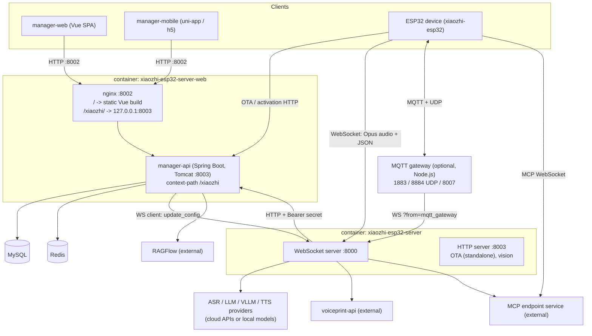
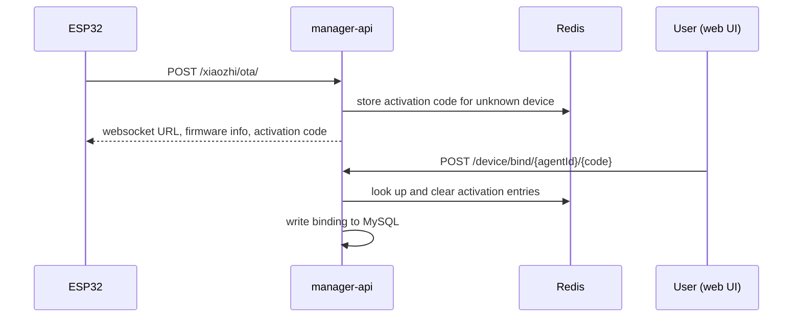

# xiaozhi-esp32-server Architecture

This document describes how the components of the full-module deployment fit together. It is based on reading the source (Python server, Java API, nginx/Docker config, docs). The mobile app (`manager-mobile`), the digital-human tool, voice cloning internals and the RAGFlow adapter were only inspected at directory level.

## 1. System overview



Only the Python server talks to the AI providers and handles audio. The Java API never touches audio.

## 2. Components

### 2.1 xiaozhi-server (Python) — `main/xiaozhi-server`

| Part | Role |
|---|---|
| `app.py` | Starts, on one asyncio loop: WebSocket server (:8000), HTTP server (:8003), GC manager (every 5 min) |
| `core/websocket_server.py` | Loads shared VAD/ASR/LLM/Memory/Intent once at startup; authenticates each connection; creates one `ConnectionHandler` per device |
| `core/connection.py` | Per-device session: message routing, audio decode, VAD/ASR/LLM/TTS orchestration, reporting, memory save on close, AEC for MQTT audio |
| `core/handle/*` | Text-message handlers (hello, listen, abort, iot, mcp, ping, server), audio receive/send, intent, report |
| `core/api/*` | HTTP handlers: OTA (standalone mode), vision (`/mcp/vision/explain`, JWT) |
| `core/providers/*` | asr, vad, llm, vllm, tts, memory, intent, tools. Loaded by name via `importlib` |
| `plugins_func/functions/*` | Server-side tool plugins (see 4.4) |
| `config/*` | `config.yaml` / `data/.config.yaml`; if `manager-api.url` is set, config is pulled from the Java API (`read_config_from_api`) |

### 2.2 manager-api (Java) — `main/manager-api`

Spring Boot with Shiro (auth), MyBatis-Plus, Liquibase (schema), Druid (pool), Knife4j (API docs), XSS filter.

| Module | Responsibility |
|---|---|
| `security` | Login, captcha, token, permissions (user vs super admin) |
| `sys` | Users, admin, system params, dictionaries, server-side manager (`/admin/server/emit-action`) |
| `agent` | Agents, templates, tags, chat history, sessions, audio playback, MCP access point, voiceprint, snapshots |
| `device` | Bind/unbind, manual add, OTA check and activation, firmware management (`/otaMag`), device tools list/call, address book |
| `model` | Model providers and model configs (LLM, ASR, TTS, ...) |
| `timbre`, `voiceclone` | Voice list, voice cloning, voice resources |
| `knowledge` | Knowledge bases and files via a RAGFlow adapter (`knowledge/rag`) |
| `correctword` | Replacement words (source→target pairs applied to the text before TTS speaks it) |
| `config` | The three endpoints the Python server calls: `/config/server-base`, `/config/agent-models`, `/config/correct-words` |
| `sms` | Aliyun SMS verification codes |

### 2.3 manager-web (Vue) — `main/manager-web`

One view per backend area: users, devices, agent role config, models, providers, OTA, params, dictionaries, agent templates, voice clone, voice resources, voiceprint, knowledge base, replacement words, address book, server-side manager, feature management. The files in `src/apis/module/*.js` map to the Java controllers. `manager-mobile` is a second client for the same API.

### 2.4 Data stores

**MySQL**: all persistent data (users, agents, devices, model configs, chat history, OTA files, knowledge metadata). Schema managed by Liquibase.

**Redis** (key builders in `common/redis/RedisKeys.java`):

| Purpose | Keys |
|---|---|
| Config cache | system params, server config, model config / names, timbre details, dictionary data |
| Auth helpers | captcha, SMS code, SMS rate limit and daily count, user id |
| Device flow | OTA activation code, activation info, agent device count, last-connected-at, temporary MAC registration |
| OTA | OTA id, download count, upload count |
| Media tokens | agent audio id, chat history download token, voice clone audio id |
| Misc | address book, knowledge base cache, version |

## 3. Main flows

### 3.1 Device onboarding



### 3.2 A voice conversation

```mermaid
sequenceDiagram
    participant D as ESP32
    participant P as xiaozhi-server
    participant A as manager-api
    participant X as ASR/LLM/TTS providers
    D->>P: WebSocket connect (device-id, token)
    D->>P: hello
    P->>A: /config/agent-models, /config/correct-words
    P-->>D: hello reply (audio params, session id)
    loop each utterance
        D->>P: Opus frames
        P->>P: decode, VAD (Silero ONNX)
        P->>X: ASR (+ voiceprint in parallel)
        P->>X: LLM stream (memory, intent, tools)
        P->>X: TTS per sentence
        P-->>D: Opus audio + text events
        P->>A: /agent/chat-history/report (queued)
    end
    D--xP: disconnect
    P->>A: generate title, save summary; save memory
```

### 3.3 Admin change reaches the running server

1. Admin saves a model / agent / param in the web UI.
2. manager-api writes MySQL and invalidates the Redis cache.
3. `POST /admin/server/emit-action`: Java stores a temporary device-id in Redis (5 min), opens a WebSocket to Python and sends `update_config` with the server secret.
4. `serverMessageHandler` verifies the secret, `WebSocketServer.update_config()` re-fetches config and rebuilds the shared models.

### 3.4 Tool calling

`core/providers/tools/unified_tool_manager` merges five sources:

| Source | Package |
|---|---|
| Server plugins | `server_plugins` |
| IoT descriptors reported by the device | `device_iot` |
| Device MCP tools | `device_mcp` |
| Server-side MCP servers (`mcp_server_settings.json`) | `server_mcp` |
| External MCP endpoint (per-agent WebSocket) | `mcp_endpoint` |

## 4. Feature list

### 4.1 Voice pipeline
- Opus audio over WebSocket; MQTT + UDP through the gateway.
- VAD: Silero (ONNX Runtime, CPU).
- ASR: local (FunASR, Sherpa-ONNX, Vosk) or API / streaming providers (Doubao, Xunfei, Aliyun, Tencent, Baidu, OpenAI, FunASRServer).
- TTS: many API providers plus local services; streaming supported.
- Server-side AEC for audio from the MQTT gateway.
- Voiceprint recognition: speaker is identified in parallel with ASR and passed to the LLM.

### 4.2 Conversation
- LLM providers: OpenAI-compatible, Ollama, OpenRouter, Dify, FastGPT, Coze, Xinference, HomeAssistant.
- VLLM vision: device posts an image to `/mcp/vision/explain`.
- Intent: `function_call`, `intent_llm`, `nointent`.
- Memory: `mem_local_short`, `mem0ai`, PowerMem, `nomem`; summary and title generation on disconnect.
- Knowledge base: RAGFlow, queried through the `search_from_ragflow` plugin and managed from the web UI.
- Replacement words applied to the text before TTS speaks it (pronunciation fixes).

### 4.3 Device management
- OTA check, activation code binding, firmware upload and download with signed links.
- Device tools list/call from the web UI.
- Address book and device-to-device calling (`call_device` plugin).
- MCP command push through MQTT.

### 4.4 Server plugins (`plugins_func/functions`)
`get_weather`, `get_news_from_chinanews`, `get_news_from_newsnow`, `get_time`, `play_music`, `web_search`, `search_from_ragflow`, `change_role`, `call_device`, `handle_exit_intent`, and Home Assistant (`hass_init`, `hass_state`, `hass_play_music`).

### 4.5 Admin console
- User and permission management (user vs super admin), SMS / captcha login.
- Agent management: role prompt, model selection, templates, tags, snapshots, chat history with audio playback and download.
- Model and provider configuration, voice (timbre) and voice clone management.
- System params, dictionaries, server-side manager (list WebSocket servers, push `update_config`).
- UI languages: Simplified Chinese, Traditional Chinese, English.

## 5. Deployment shapes

| Mode | Components |
|---|---|
| Simple | Python server only; config in YAML; no database |
| Full | Python server + Java API / nginx + MySQL + Redis (`docker-compose_all.yml`, four containers) |
| Optional extras | RAGFlow, voiceprint-api (needs MySQL), MQTT gateway, MCP endpoint, FunASR server |

Ports: 8000 (WebSocket), 8003 (Python HTTP), 8002 (console, nginx); inside the web container Java listens on 8003. MQTT gateway uses 1883 (TCP), 8884 (UDP), 8007 (TCP).

## 6. Resource notes

- The always-on heavy parts are the JVM and the Python process holding the shared models; in full mode MySQL, Redis and nginx add fixed overhead.
- The Java API is mostly I/O and cache lookups, so its heap and pools can be capped.
- Python audio / AI work is concentrated in one asyncio loop (one core for the event loop) plus per-connection threads; local ASR (FunASR) is the dominant CPU and RAM cost.
