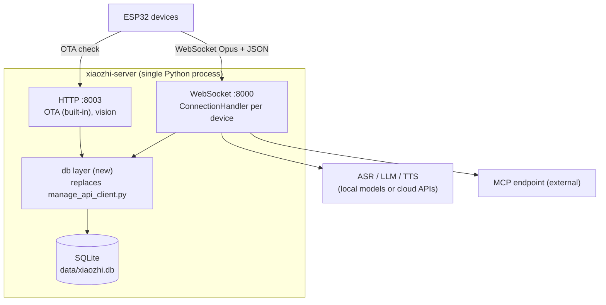

# Minimal Personal Server: Design (draft for review)

Branch: `minimal_server` (created from `feature/openrouter-llm-provider`, which is left unchanged).

## 1. Goal

Run `xiaozhi-server` (Python) as a single process for personal use. Remove the Java `manager-api`, the Vue web console, the mobile app, MySQL, Redis, nginx and RAGFlow. Replace them with one SQLite file that holds config, agents, devices, chat history (with audio) and LLM usage/cost.

Non-goals (for now): web UI or CLI for editing (SQLite is edited by hand), ASR/TTS cost tracking, multi-user accounts, RAGFlow.

## 2. Decisions taken

| # | Topic | Decision |
|---|---|---|
| 1 | Devices / agents | A few devices, a few agents. New agents are created by inserting a row into `agent` |
| 2 | ASR | All ASR provider code stays. Seeded: `ASR_OpenRouter` (new, enabled) and `ASR_FunASR` (disabled) |
| 3 | Optional features | Keep MCP endpoint. **Drop** MQTT gateway, vision, voiceprint (own implementation later). Memory: see section 3 |
| 4 | Config location | Everything in SQLite |
| 5 | Editing | By hand in SQLite for now; CLI / local page later |
| 6 | Chat audio | Stored in SQLite (BLOB) |
| 7 | Chat history | Kept forever |
| 8 | Usage / cost | LLM now; OpenRouter STT when implemented (same `ai_usage` table); TTS later |
| 9 | OTA | Keep the built-in Python OTA endpoint (no firmware management) |
| 3a | Memory | Keep `mem_local_short`; stored **per device** (MAC); on/off per agent through `agent.mem_id` (point it at the `nomem` model row to turn it off) |
| 3b | Replacement words | Keep. Global in v1 (table `replacement_word`, `agent_id` NULL); per-agent rows can be added later without a schema change |
| 3c | Intent | `function_call` only (`intent_llm` and `nointent` rows are not seeded) |
| 3d | Plugins | Code kept, but all server plugins switched off globally so none reach the LLM (see section 6a) |
| 3e | Guardrails | One small layer: mask names, phones, emails and card numbers in **user text** before it reaches the LLM, memory, logs or the database. Numbered placeholders, switchable on/off by setting (section 6c). LLM replies are not checked. Caching: out of scope |
| 10a | Unknown devices | Auto-register to the default agent |
| 10b | Remote branch | `feature/openrouter-llm-provider` keeps its original name on `origin`; this work lives on `minimal_server` |
| 10 | Deployment | Run with Python during development, Docker afterwards |
| 11 | Branch | `minimal_server` |

## 3. Feature notes (what they are, and what was decided)

### MQTT gateway (dropped)
Normally a device holds a WebSocket to the server. The MQTT gateway is a separate Node.js project (`xiaozhi-mqtt-gateway`). The device talks MQTT (control) + UDP (audio) to the gateway, and the gateway talks WebSocket to xiaozhi-server (`...?from=mqtt_gateway`). Benefits: lower power use on battery devices, and the server can push commands to a sleeping device. Costs: one more service, three open ports (1883, 8884/UDP, 8007), a signing key. The server contains the gateway-side code (AEC, 16-byte audio header, MQTT config in the OTA reply).
**Recommendation: drop it** unless you have battery devices that must sleep. WebSocket is enough on a LAN.

### Vision (VLLM) (dropped)
A device with a camera posts an image to `/mcp/vision/explain`; a vision-capable model (e.g. glm-4v-flash, qwen3.5-flash) describes it and the answer is spoken ("what is this?"). It needs a VLLM entry in `model_config` and the HTTP port to be reachable by the device. If your devices have no camera, drop it.

### Memory
Lets the agent remember across conversations. Providers present in `core/providers/memory`:
- `nomem`: no memory.
- `mem_local_short`: after each conversation the LLM writes a short summary that is injected into the next system prompt. Stored per device (keyed by MAC); no extra service. **Recommended.**
- `mem_report_only`: only reports history, no memory injection.
- `mem0ai`: cloud service (mem0.ai), API key, 1000 calls/month free.
- `powermem`: OceanBase open-source library. Local summarisation through an LLM plus its own store (can be SQLite). Smarter retrieval, heavier dependency.
**Recommendation: `mem_local_short` plus `nomem` as an option; drop mem0ai and powermem.**

### OTA (kept, Python endpoint only)
Not only firmware update. When an ESP32 boots it POSTs to an OTA URL (`/xiaozhi/ota/`) and the reply tells it: server time, the WebSocket URL (or MQTT config) to use, an auth token if enabled, and whether newer firmware exists. So without an OTA endpoint the device does not know where your server is, unless the URL is compiled into the firmware.
The Python server already has its own handler (`core/api/ota_handler.py`, HTTP :8003). It returns the WebSocket URL, an optional token, and serves firmware from `data/bin` if present. That is independent of the Java API.
**Recommendation: keep the built-in Python OTA endpoint (it is small), drop firmware upload/management (no `ai_ota` table; just drop `.bin` files in a folder if you ever need it).**

### Voiceprint (dropped for now)
Speaker recognition is done by a separate service (`voiceprint-api`, 3D-Speaker model) that needs its own MySQL. It is dropped from this version; a custom implementation can be added later. The schema leaves room for it (a `voiceprint_speaker` table can be added without touching existing tables).

### Replacement words (what they are)
A list of `source|target` pairs per agent. Before the TTS speaks a sentence, every occurrence of `source` in the text is replaced by `target` (one regex pass, longest match first; `core/providers/tts/base.py`). The subtitle sent to the device is restored to the original text. Use: fix mispronunciations, e.g. make the TTS say the right reading for a name, an acronym or a product. It does not touch ASR output. **Decision: keep, global in v1.** Stored in table `replacement_word` (rows with `agent_id` NULL apply to every agent; a later per-agent row overrides a global row with the same `source`) and fed into the existing `correct_words` config key as `source|target` strings, so the TTS code does not change.

### Memory (`mem_local_short`) in detail
What it does, step by step (`core/providers/memory/mem_local_short`):
1. **When a connection closes**, `save_memory()` is called in a background thread with the whole conversation (needs at least 2 messages).
2. It builds one prompt text: every turn as `User: ...` / `Assistant: ...`, then the **previous memory** (if any), then the current time.
3. It asks the **LLM** (non-streaming, max 2000 tokens, temperature 0.2) with a long fixed instruction prompt ("Spatiotemporal Memory Weaver"). That prompt tells the model to merge old and new information into one JSON document: identity (current/former names, tags), a list of remembered events with timestamp, emotion value and shelf life, frequent topics, pending items (things to follow up on), and memorable quotes. It also tells the model to compress and drop low-value items when the text passes about 900 characters.
4. The JSON is validated and stored as **one text blob per device**. Today that blob is a key in `data/.memory.yaml`, keyed by the device id (`connection.py:966`, `role_id=self.device_id`); in this design it becomes the `memory` table row for that MAC.
5. **When the next connection starts**, the blob is loaded and injected into the system prompt, so the LLM "remembers" the user.

Properties:
- No extra service, no vector search, no embeddings; memory is only ever a single summary of about 1 KB.
- It costs one extra LLM call per conversation (this call should also be recorded in `ai_usage`).
- Memory is per **device** (MAC), not per agent or per speaker. Two devices using the same agent keep separate memories; moving a device to another agent keeps its memory.
- Quality depends on the summarising model; if the model returns invalid JSON the update is skipped and the old memory is kept.
- Alternatives (`mem0ai`, `powermem`) give per-fact storage and retrieval but need a cloud key or a heavy library. Not kept.

**Decision: keep `mem_local_short` and `nomem`; drop `mem0ai`, `powermem`, `mem_report_only`.** (The last one only reports history to the Java API, which no longer exists.)

### Audio format
Conversion works in both directions with `ffmpeg` / `opuslib` (both already in the image), but only one direction is lossless: Opus -> WAV decodes without extra loss (you get what the device or TTS produced), while WAV -> Opus is a second lossy encode. The device sends Opus and the TTS output is encoded to Opus, so **store Opus** (user audio is encoded on save, see section 5 notes) and decode to WAV only when you need playback or export. Size: Opus about 3 KB/s vs WAV 16 kHz mono 32 KB/s (about 10x). Opus packets are individual frames, so the BLOB uses a simple length-prefixed container (`format='opus-frames'`, with the sample rate saved next to it). The current report code builds WAV first; that step is replaced by "store frames as received".

## 4. Target architecture



Removed: manager-api, manager-web, manager-mobile, nginx, MySQL, Redis, RAGFlow, MQTT gateway, vision, voiceprint.

## 5. SQLite schema (proposal)

Conventions: `TEXT` ids (uuid hex), timestamps as ISO-8601 UTC text, JSON stored as `TEXT` with `CHECK (json_valid(...))`. Pragmas: `journal_mode=WAL`, `foreign_keys=ON`, `busy_timeout=5000`.

```sql
-- Global settings; same dotted keys as the old sys_params
CREATE TABLE setting (
  key   TEXT PRIMARY KEY,           -- e.g. 'server.port', 'log.log_level', 'exit_commands'
  value TEXT NOT NULL,              -- JSON-encoded value
  note  TEXT
);

CREATE TABLE model_config (
  id          TEXT PRIMARY KEY,     -- e.g. 'LLM_OpenRouter', same ids as before
  model_type  TEXT NOT NULL,        -- VAD|ASR|LLM|TTS|Memory|Intent
  model_code  TEXT NOT NULL,        -- provider type, e.g. 'openrouter', 'FunASR'
  name        TEXT NOT NULL,
  config_json TEXT NOT NULL CHECK (json_valid(config_json)),  -- keys, urls, model names
  enabled     INTEGER NOT NULL DEFAULT 1
);

CREATE TABLE agent (
  id              TEXT PRIMARY KEY,
  name            TEXT NOT NULL,
  is_default      INTEGER NOT NULL DEFAULT 0,       -- used for unknown devices
  system_prompt   TEXT,
  language        TEXT,
  vad_id TEXT REFERENCES model_config(id),
  asr_id TEXT REFERENCES model_config(id),
  llm_id TEXT REFERENCES model_config(id),
  tts_id TEXT REFERENCES model_config(id),
  mem_id TEXT REFERENCES model_config(id),
  intent_id TEXT REFERENCES model_config(id),
  tts_voice       TEXT,
  tts_params_json TEXT,                            -- {"language","volume","rate","pitch"}
  history_mode    INTEGER NOT NULL DEFAULT 2,      -- 0 off, 1 text, 2 text+audio
  plugins_json    TEXT,                            -- per-agent plugin params
  mcp_endpoint    TEXT,
  context_providers_json TEXT
);

CREATE TABLE replacement_word (                     -- TTS text substitutions
  id       INTEGER PRIMARY KEY AUTOINCREMENT,
  agent_id TEXT REFERENCES agent(id),              -- NULL = global (v1 uses only global rows)
  source   TEXT NOT NULL,
  target   TEXT NOT NULL
);
CREATE UNIQUE INDEX idx_replacement_unique ON replacement_word(COALESCE(agent_id, ''), source);

CREATE TABLE memory (                               -- replaces data/.memory.yaml (one row per device)
  device_mac TEXT PRIMARY KEY REFERENCES device(mac),
  summary    TEXT,
  updated_at TEXT
);

CREATE TABLE device (
  mac               TEXT PRIMARY KEY,
  agent_id          TEXT NOT NULL REFERENCES agent(id),
  alias             TEXT,
  board             TEXT,
  app_version       TEXT,
  last_connected_at TEXT
);

CREATE TABLE chat_session (
  id         TEXT PRIMARY KEY,                    -- the connection's session_id
  device_mac TEXT NOT NULL,
  agent_id   TEXT NOT NULL,
  title      TEXT,
  summary    TEXT,
  started_at TEXT NOT NULL,
  ended_at   TEXT
);

CREATE TABLE chat_message (
  id         INTEGER PRIMARY KEY AUTOINCREMENT,
  session_id TEXT NOT NULL REFERENCES chat_session(id),
  chat_type  INTEGER NOT NULL,                    -- 1 user, 2 agent, 3 tool call
  content    TEXT NOT NULL,
  audio_id   INTEGER REFERENCES chat_audio(id),
  created_at TEXT NOT NULL
);
CREATE INDEX idx_msg_session ON chat_message(session_id, id);

CREATE TABLE chat_audio (                           -- separate table keeps BLOBs out of message scans
  id     INTEGER PRIMARY KEY AUTOINCREMENT,
  format      TEXT NOT NULL,                      -- 'opus-frames' (length-prefixed packets)
  sample_rate INTEGER NOT NULL,
  data        BLOB NOT NULL
);

CREATE TABLE guardrail_name (                       -- names to mask (filled by hand)
  id      INTEGER PRIMARY KEY AUTOINCREMENT,
  name    TEXT NOT NULL UNIQUE COLLATE NOCASE,
  note    TEXT,
  enabled INTEGER NOT NULL DEFAULT 1
);

CREATE TABLE ai_usage (
  id                INTEGER PRIMARY KEY AUTOINCREMENT,
  record_id         TEXT UNIQUE,                  -- UsageRecord.record_id
  created_at        TEXT NOT NULL,
  kind              TEXT NOT NULL DEFAULT 'llm',  -- llm | stt | tts
  session_id        TEXT,
  device_mac        TEXT,                         -- which ESP32 (copied at call time)
  agent_id          TEXT,                         -- which agent (copied at call time, survives re-assignment)
  purpose           TEXT,                         -- chat | intent | memory | title | summary | stt | tts
  call_kind         TEXT,                         -- llm: chat | chat_functions | no_stream
  requested_model   TEXT,
  served_model      TEXT,                         -- NULL for stt (not reported)
  provider          TEXT,                         -- NULL for stt (not reported)
  generation_id     TEXT,                         -- NULL for stt
  prompt_tokens     INTEGER,
  completion_tokens INTEGER,
  total_tokens      INTEGER,
  cost              REAL,                         -- OpenRouter usage.cost (USD)
  upstream_cost     REAL,
  is_byok           INTEGER,
  audio_seconds     REAL,                         -- stt/tts units (NULL for llm)
  ttft_ms           INTEGER,
  duration_ms       INTEGER
);
CREATE INDEX idx_usage_time   ON ai_usage(created_at);
CREATE INDEX idx_usage_device ON ai_usage(device_mac, created_at);
CREATE INDEX idx_usage_agent  ON ai_usage(agent_id, created_at);

-- Ready-made reports (query with plain SQL or any SQLite browser)
CREATE VIEW usage_by_device AS
  SELECT device_mac, kind, date(created_at, 'localtime') AS day, COUNT(*) AS calls,
         SUM(prompt_tokens) AS prompt_tokens, SUM(completion_tokens) AS completion_tokens,
         SUM(total_tokens) AS total_tokens, SUM(cost) AS cost_usd
  FROM ai_usage GROUP BY device_mac, kind, day;
CREATE VIEW usage_by_agent AS
  SELECT agent_id, kind, date(created_at, 'localtime') AS day, COUNT(*) AS calls,
         SUM(prompt_tokens) AS prompt_tokens, SUM(completion_tokens) AS completion_tokens,
         SUM(total_tokens) AS total_tokens, SUM(cost) AS cost_usd
  FROM ai_usage GROUP BY agent_id, kind, day;
```

### Usage attribution (per device and per agent)
- Every `ai_usage` row carries `device_mac`, `agent_id` and `session_id`, copied at call time. Re-assigning a device to another agent later does not rewrite history, so per-agent totals stay correct.
- The Python side has the `device_id` (MAC) on the connection but today has no `agent_id`; the new data layer resolves device -> agent when it builds the per-device config, and stores it on the `ConnectionHandler`.
- **All LLM calls must be attributed, not just chat.** The intent, memory-summary and title calls use `response_no_stream` on other code paths (memory and title run in a background thread with their own event loop at disconnect). The `UsageRecord` therefore needs the attribution passed explicitly (or through a `contextvars` value copied into those threads), and `purpose` says why the tokens were spent. Without this, memory/title cost would show as unattributed.
- Example questions the views answer: "tokens and USD per device this week", "which agent costs the most", "how much does memory summarising cost versus chat".
- `cost` is only known when the provider reports it (OpenRouter does). For other providers it is NULL; token counts are still stored.

Dropped versus the MySQL schema: users/tokens/dicts, OTA, RAG, tags, snapshots, address book, voices/voice clone, templates (replaced by `agent.is_default`), correct-word tables (replaced by `replacement_word`), chat-title as its own table (now `chat_session.title`).

Notes:
- **Audio size:** WAV 16 kHz mono is about 115 MB per hour of speech; Opus is about 10x smaller. The current report path converts to WAV. Decision: store Opus (see "Audio format" in section 3). The server decodes each received Opus packet to PCM on arrival and discards the packet (`connection.py:381`), so **user audio is PCM and is encoded to Opus once when saved** (one lossy encode, using the existing `opus_encoder_utils`); agent audio already is Opus from the TTS encoder and is stored as is.
- **Unknown devices:** the old flow forced a bind code. With no console, an unknown MAC is auto-inserted into `device` pointing to the `is_default` agent. Setting `device.auto_register` (default `true`); when `false`, an unknown MAC is refused (connection closed with a message).
- **Schema version:** `PRAGMA user_version = 1` is set by the schema script; later changes are numbered migrations applied at startup. Timestamps are UTC text; the usage views group by local day via `date(created_at, 'localtime')`.
- **`history_mode` -> `chat_history_conf`:** same values (0 off, 1 text, 2 text+audio).

## 6. How the code changes

Today everything goes through `config/manage_api_client.py` over HTTP and is switched on by `read_config_from_api`.

| Area | Change |
|---|---|
| New `core/db/` (or `config/db.py`) | Open SQLite, apply schema, helper queries. Sync `sqlite3` in a dedicated writer thread for inserts; reads are short |
| `config/config_loader.py` | Build the same config dict from `setting` + default agent's models (replaces `get_config_from_api_async` / `/config/server-base`) |
| `get_private_config_from_api` | New `get_agent_config(mac)` that builds the per-device dict from `device` → `agent` → `model_config` (replaces `/config/agent-models`). Same keys: `selected_module`, per-type configs, `prompt`, `summaryMemory`, `plugins`, `mcp_endpoint`, `voiceprint`, `chat_history_conf` |
| `core/handle/reportHandle.py` | Write to `chat_message` / `chat_audio` instead of POSTing |
| `core/connection.py` | Replace `DeviceNotFound/DeviceBind` handling with the auto-register rule; title/summary at disconnect written to `chat_session`; chat/usage writes go to one process-wide DB writer thread (see "Database access rules") |
| Memory (`mem_local_short`) | Read/write `memory` table instead of `data/.memory.yaml` |
| OpenRouter usage | Add a sink registered with `usage.py` `emit_usage()`; the default log sink stays |
| `serverMessageHandler.py` | `update_config` secret/API logic removed or reduced |
| OpenAI provider | Optional: emit the same `UsageRecord` so non-OpenRouter LLMs also fill `ai_usage` (cost would be NULL) |
| Gates `read_config_from_api` | Renamed to a `db_enabled` style flag; always true in this build |
| Remove | Java `main/manager-api`, `manager-web`, `manager-mobile`, `Dockerfile-web`, `docker-compose_all.yml` Java/MySQL/Redis services, related docs |

### Database access rules
- Module `core/db/` exposes a small `Database` class. Schema in `core/db/schema.sql`, applied idempotently at startup (`CREATE TABLE IF NOT EXISTS` + `user_version`).
- **Reads** (config assembly, device lookup, memory): one `sqlite3` connection per thread (`threading.local`), called from async code through `asyncio.to_thread`, so the event loop is never blocked.
- **Writes** (chat rows, audio, usage, memory, `last_connected_at`): put on a queue consumed by **one** writer thread for the whole process (avoids `database is locked`). `PRAGMA journal_mode=WAL`, `busy_timeout=5000`, `foreign_keys=ON`.
- Failures in the writer are logged and never break a conversation.
- The OTA HTTP handler and the WebSocket server use the same module.

### Bootstrap (what stays outside the database)
`data/.config.yaml` keeps only what is needed before the database can be opened: `db.path` (default `data/xiaozhi.db`, overridable with env `XIAOZHI_DB`), the `log` block (the logger starts at import time) and `server.ip` / `server.port` / `server.http_port`. Everything else comes from the database.

### Config key inventory (what `get_agent_config(mac)` must produce)
Keys read by `ConnectionHandler` when a device connects (from `connection.py` `_initialize_private_config_async`), and where each comes from in the new design:

| Config key | Source |
|---|---|
| `selected_module.{VAD,ASR,LLM,TTS,Memory,Intent}` | `agent.*_id` (the `model_config.id`) |
| `VAD` / `ASR` / `LLM` / `TTS` / `Memory` / `Intent` = `{id: config}` | `model_config.config_json` of the selected rows. The `Memory` row names the LLM it uses in its `llm` key, so that LLM row must be included |
| TTS extras: `private_voice`, `language`, `volume`, `rate`, `pitch` | `agent.tts_voice`, `agent.tts_params_json` |
| `correct_words` (list of `source\|target`) | `replacement_word` (global rows now) |
| `prompt` | `agent.system_prompt` (falls back to `setting prompt`, rendered with `prompt_template`) |
| `summaryMemory` | `memory.summary` for this MAC |
| `plugins` | `agent.plugins_json` (only used when `tools.server_plugins_enabled` is true) |
| `mcp_endpoint`, `context_providers` | `agent.mcp_endpoint`, `agent.context_providers_json` |
| `chat_history_conf` | `agent.history_mode` |
| `device_max_output_size` | `setting` |
| `delete_audio`, `tts_timeout` | `setting` (copied by existing code) |
| `voiceprint`, `VLLM` | not produced (features dropped) |

Global keys stay in `setting` as dotted keys (turned into nested dicts like Java did): `server.*`, `exit_commands`, `wakeup_words`, `xiaozhi` (hello block with `audio_params`), `end_prompt.*`, `close_connection_no_voice_time`, `tool_call_timeout`, `enable_*` flags, `plugins.*`, `tools.server_plugins_enabled`, `device.auto_register`, `server.timezone_offset`, `guardrails.*`. The seed script writes them from the defaults in `config.yaml`. `prompt_template` remains the file `agent-base-prompt.txt` in the repo. Phase 1 turns this table into a checked test: the assembled dict must contain every key above.

### 6a. Plugins: kept in the code, off at runtime
The LLM only sees tools that the tool manager collects from five sources (`unified_tool_handler.py`): server plugins, server MCP, device IoT, device MCP and the MCP endpoint. Server plugins are the files in `plugins_func/functions/` (weather, news, music, search, change_role, exit, Home Assistant, ...). They are listed by name in `Intent.function_call.functions` and in each agent's plugin mapping.

Design: add one setting `tools.server_plugins_enabled` (default `false`). When false, `ServerPluginExecutor.get_tools()` returns nothing, so no plugin description is sent to the LLM and none can be called. The plugin files, their config keys and `agent.plugins_json` stay untouched, so enabling them later is a one-line setting change plus filling in their keys. The seed `function_call` model row ships with an empty `functions` list.

What stays active regardless: the virtual `direct_answer` tool, device-reported tools (IoT / device MCP) and the MCP endpoint, (decided: keep).

### 6b. OpenRouter STT provider (new ASR provider)
Facts below were reported by the `openrouter-sdk` Claude session from the SDK source (`openrouter` 1.3.43, `src/openrouter/stt.py` and `components/stt*.py`). They were not re-read by this session; items marked [I] are inference. Verify with a live call before relying on them, as was done for the LLM provider.

**Shape.** A new `core/providers/asr/openrouter_stt.py` (`ASRProvider`, `InterfaceType.NON_STREAM`-style like `fun_local.py`). `speech_to_text` receives the finished utterance (`artifacts.pcm_bytes`, 16 kHz mono s16le) and returns `(text, file_path)`. No streaming.

**Call.** `await client.stt.create_transcription_async(input_audio={"data": <base64>, "format_": "pcm"}, model=..., language=..., timeout/retries...)` -> `STTResponse`. Endpoint `POST https://openrouter.ai/api/v1/audio/transcriptions`.
- Audio: JSON/base64 variant (the multipart variant has a 25 MB limit and takes a filename). `format_="pcm"` is documented as headerless s16le mono 16 kHz, matching our data exactly. [I] Not every model/provider may honour `pcm`; fallback is wrapping as WAV and sending `"wav"` (make the format a config key `audio_format`, default `pcm`).
- Model: free string, config key `model_name`. Only `openai/whisper-large-v3` appears in the SDK docs; list valid ones with `client.models.list(output_modalities="transcription")`.
- `language`: ISO-639-1 code (`"en"`, `"vi"`), omit for auto-detect. Config key `language`.
- Optional request fields to expose as config: `temperature`, `response_format` (`json` default), `provider` (`data_collection: allow|deny`, `zdr`, `options`; note there is **no** order/only/ignore routing for STT), `keyterms`, `diarize` (needs `verbose_json`).
- `session_id`, `user`, `trace` are observability-only; pass `session_id` and the device MAC.

**Client lifecycle.** One long-lived `OpenRouter` client created at provider init and reused (shared ASR instance); close it on shutdown with `__aexit__` (the instance cannot be reused afterwards). Set `timeout_ms` explicitly (httpx default is 5 s [I], too short) e.g. 15000, and per-call `retries` with a short backoff (SDK default retries 5xx for up to 1 hour, far too long for voice); 429 is not retried by default. Set attribution (`http_referer`, `x_open_router_title`).

**Errors.** Typed `OpenRouterError` subclasses (400, 401, 402, 403, 404, 413, 429, 5xx...) with `.status_code`/`.headers`; transport problems arrive as raw `httpx.TimeoutException` / `httpx.NetworkError`. The provider catches `(httpx.HTTPError, OpenRouterError)`, logs, and returns an empty transcript so the conversation continues. Empty or silent audio: `text` is a required string, so expect `""` (guard it); `verbose_json` segments carry `no_speech_prob`.

**Response and usage.** `STTResponse.text` (required); everything else optional. `usage` has only `cost` (USD), `input_tokens`, `output_tokens`, `total_tokens`, `seconds` (all optional). **There is no generation id, served model, provider name or `is_byok` in the STT response**, and the SDK does not expose response headers. Consequences for `ai_usage`:
- STT rows store `requested_model`; `served_model`, `provider`, `generation_id`, `is_byok` stay NULL (all nullable; `generation_id` column added).
- `audio_seconds` = `usage.seconds` if present, otherwise computed from the PCM length (`len/32000`); `prompt/completion/total_tokens` and `cost` copied from `usage` when present.
- Optional later step: an `AfterSuccessHook` to read a generation-id header and `client.generations.get_generation()` for the real cost breakdown (one extra request per call, may lag); not in v1.

**Config row (seed).** `ASR_OpenRouter`: `type: openrouter_stt`, `api_key`, `model_name`, `language`, `audio_format`, `timeout_ms`, optional `provider` options. A disabled `ASR_FunASR` row is seeded next to it for A/B comparison.

**Tests.** Offline tests with a stubbed client (success, empty text, 401/429/5xx, timeout, usage None). Live tests with the user's key, kept separate, like the LLM provider.

### 6c. Guardrails: masking personal data in user text
Scope for v1: one small layer on **user text only**. LLM replies are not checked. Caching is out of scope.

**What is masked** (replaced by a numbered placeholder, the original is not sent on):

| Type | Placeholder | Detection |
|---|---|---|
| Email | `[EMAIL_1]` | Regex |
| Card number | `[CARD_1]` | 13-19 digits, optional spaces/dashes, **Luhn checksum** must pass |
| Phone | `[PHONE_1]` | Vietnamese (`0` + 9 digits, `+84`...) and generic international `+` numbers; spaces, dots and dashes allowed between digits |
| Name | `[NAME_1]` | Exact match against rows in `guardrail_name` (case-insensitive, whole word, Unicode-normalised, longest first). Empty list = nothing masked. There is no automatic name detection. |

Order of application: email, card, phone, name (so a longer match is not split by a shorter one). The same original value gets the same placeholder within one connection (`[PHONE_1]` twice means the same number); different values get `_2`, `_3`.

**Where it runs.** Once, as early as possible: right after ASR returns the text and before the first log line and before the text goes anywhere else (`ASRProviderBase.handle_voice_stop`, `core/providers/asr/base.py:84`, immediately after `raw_text` is obtained at about line 120 and before the recognized text is logged; all ASR providers, streaming ones included, go through this method. When `raw_text` is the JSON form with a `content` field, mask `content`). After that, everything downstream sees only masked text: LLM prompt, dialogue history, memory summary, logs, `chat_message` rows. The original text is not stored anywhere, so it cannot be recovered from the database.

**Settings** (`setting` table, all JSON values):

| Key | Default | Meaning |
|---|---|---|
| `guardrails.enabled` | `true` | Master switch. `false` = no masking at all |
| `guardrails.mask_email` / `mask_phone` / `mask_card` / `mask_name` | `true` | Per-type switches |
| `guardrails.restore_in_reply` | `false` | If `true`, placeholders in the LLM's reply are replaced by the real value (kept in memory per connection) before the text goes to the TTS. The LLM still never sees the real value |

The per-connection mapping lives on the `ConnectionHandler` (in memory only, dropped when the connection closes). Settings are read per connection, so a change applies from the next connection.

**Known limits (accepted):**
- Stored audio (`chat_audio`) keeps the real voice, including any spoken number or name. All audio is stored by decision.
- The STT provider (OpenRouter STT, or FunASR locally) receives the raw audio before any text exists; masking protects the LLM, logs and database only.
- Numbers spoken as words ("khong chin mot hai ...") are not detected in v1 unless the ASR writes digits.
- Names not in `guardrail_name` are not masked. Masking also means memory cannot keep the masked details (e.g. a friend's name).
- LLM replies are not inspected (decision).

**Tests.** Pure-function unit tests (phone/email/card positive and negative cases, Luhn failures, overlapping matches, same-value-same-placeholder, name list, switches off, restore on/off, Vietnamese diacritics).

### Config reload by hand edits
Per-device config is built when a device connects, so edits to `agent`, `model_config` and per-agent settings apply to the **next connection**. The shared VAD/ASR/LLM/Memory/Intent instances are created once at startup (`WebSocketServer.__init__`), so changing the default ASR/VAD needs a restart (or a later CLI command that triggers the existing `update_config`).

## 7. Resource effect (estimate, not measured)

Fixed cost drops from four containers (JVM + MySQL + Redis + nginx + Python) to one Python process. With FunASR unchanged the Python process still needs about 2-3 GB; the other components add roughly 1-1.5 GB today, so the full-mode figure should land close to the old "simple mode with FunASR" (2 cores / 4 GB). Verify with `docker stats` before and after.

## 8. Phases (each with a "done when")

1. **Schema + db layer + seed.** Done when: `python -m core.db.seed` creates an empty DB with all tables, views and seed rows, can be run twice without error, and unit tests (in-memory SQLite) pass for read/write/writer-thread behavior and for the config-key inventory test (the assembled dict contains every key in the table above).
2. **Config assembly from SQLite.** Done when: the server starts with no `manager-api` config, a device connects over WebSocket with `device.auto_register` on, gets its agent's models/prompt, and a text-only conversation works end to end; unknown-device refusal works with the setting off; `tools.server_plugins_enabled=false` sends no plugin tools to the LLM (tested).
3. **Chat history + audio + titles + memory + guardrails.** Done when: rows appear in `chat_session`/`chat_message`/`chat_audio` (Opus, playable after decode), title and memory are written at disconnect for the right device, memory is loaded on the next connect, guardrail unit tests pass and masked text is what reaches the LLM, the log and the database.
4. **Usage sink + OpenRouter STT.** Done when: every LLM call (chat, memory, title) writes an `ai_usage` row with device, agent, session, purpose, tokens and cost; the OpenRouter STT provider passes offline tests and a live test; `usage_by_device` / `usage_by_agent` return correct sums for a scripted scenario (including an agent change midway).
5. **Remove Java/web/mobile, simplify Docker, update docs.** Done when: the repo builds and runs with one Docker service and one volume (`data/`), docs no longer mention the removed parts, and the full test suite passes.
6. **Measure resources.** Done when: `docker stats` numbers before/after are recorded in this doc.

## 9. Open questions

None open. Ready for review.

Resolved:
- `end_prompt` kept (English for now, like `exit_commands`).
- Usage is attributable per device and per agent (section 5, "Usage attribution").
- Usage table is general: `ai_usage` with a `kind` column (`llm` | `stt` | `tts`).
- WebSocket auth off (trusted LAN). Exit words stay English (`exit`, `quit`, `goodbye`).
- OpenRouter STT is non-streaming (confirmed); it is added as one more ASR provider, and its performance will be compared with FunASR later.
- `docs/openrouter-llm-provider-plan.md` is marked superseded. The shared QWeather API key was removed from `config.yaml` and from the `get_weather.py` default.
- MQTT, vision and voiceprint dropped; OTA kept (Python); unknown devices auto-registered; Opus audio storage; `history_mode` default 2.
- Memory kept, switchable per agent; replacement words kept (global); intent = `function_call` only; server plugins off; device/MCP-endpoint tools kept.
- Seed data: VAD `SileroVAD`, LLM `openrouter`, ASR `openrouter` (new provider, to be implemented in this work), TTS `EdgeTTS`, Memory `mem_local_short` + `nomem`, Intent `function_call`. All other provider code stays in the repo, but is not seeded. FunASR may be seeded as a disabled row.
- Plain-text API keys in the local SQLite file (git-ignored); empty database to start; the DB is dropped and re-created per test, so the seed script must be idempotent; OTA timezone offset +7 (`server.timezone_offset`); work done on branch `minimal_server`.

## 10. Implementation notes

Deviations and decisions made while implementing phases 1 and 2 (on branch `minimal_server`).

### Phase 1 (schema, db layer, seed)
- **Seed ASR: FunASR now, OpenRouter STT later.** Section 2/9 seed `ASR_OpenRouter` as enabled and `ASR_FunASR` as disabled. Because the `openrouter_stt` provider does not exist until phase 4, the seed does the reverse for now: `ASR_FunASR` is enabled and is the default agent's `asr_id`; `ASR_OpenRouter` (`type: openrouter_stt`, empty `api_key`) is seeded with `enabled = 0`. Phase 4 flips both flags and the agent's `asr_id`. The seed is `INSERT OR IGNORE`, so flipping them by hand is not undone by a re-run.
- **Disabled models are not selectable.** `model_config.enabled = 0` means the assembly skips the row (with a warning), so a type can be missing from the per-device dict; the connection then keeps the shared default instance for that type.
- **Schema.** `core/db/schema.sql` is design section 5 with `IF NOT EXISTS` added to every statement and `PRAGMA user_version = 1` at the end. It is applied only when `user_version < 1`. No other change (no extra indexes, e.g. no unique "one default agent" index; the assembly takes the first `is_default = 1` agent).
- **Timestamps** are written as `YYYY-MM-DDTHH:MM:SSZ` (`utcnow_iso()`), which SQLite's `date(..., 'localtime')` in the usage views accepts.
- **Database class.** Reader connections are `query_only`; one writer thread is started lazily; `submit()/write()/insert()` return a `Future` (failures are logged by the writer and stored in the Future, never raised into the caller); `write_sync()` returns `False` instead of raising. `core/db` uses stdlib only; for logging it uses loguru when importable (so lines reach the server log) and falls back to stdlib `logging`.
- **Relative paths** (`db.path`, `--db`, `XIAOZHI_DB`) are resolved against `main/xiaozhi-server`, not the working directory. Precedence: explicit argument/bootstrap value, then env `XIAOZHI_DB` (the loader applies the env var over `db.path`), then `data/xiaozhi.db`.
- **TTS extras** (`private_voice`, `language`, `volume`, `rate`, `pitch`) are placed inside the selected TTS model's config dict (`config["TTS"][tts_id]`), because the TTS providers read them from their own config, not from the top level. The assembled dict also carries one extra key, `agent_id`, so the connection can attribute usage later (section 5, "Usage attribution").
- **`plugins`** in the per-device dict holds native dicts (not JSON strings as the Java API sent); the connection accepts both. If the agent has no plugin entries, the global `plugins.*` settings and the Intent model's `functions` list apply unchanged; with entries, they override the global values per plugin and define the function list (old behaviour).
- **Seed content details.** Plugin parameter blocks come from `config.yaml` (`plugins.<name>` settings, placeholders such as `your_qweather_api_key`); `search_from_ragflow` is not seeded (RAGFlow is dropped). `server.mqtt_*`, `server.vision_explain` and `voiceprint` are not seeded (features dropped). `server.websocket` keeps the `config.yaml` placeholder (the OTA handler falls back to `ws://<local ip>:<port>/xiaozhi/v1/` when it contains `your_`). `module_test`, `system_error_response` and `stop_tts_notify_voice` are seeded because code reads them. The default agent's prompt is `prompt` from `config.yaml`. The EdgeTTS voice is still `config.yaml`'s `zh-CN-XiaoxiaoNeural` (default kept; change it by editing the `TTS_EdgeTTS` row or `agent.tts_voice`).

### Phase 2 (config assembly wired in)
- **Startup config.** `load_config()` = bootstrap (`db.path`, `log`, `server.ip/port/http_port/auth_key` from `config.yaml` defaults overridden by `data/.config.yaml`, plus env `XIAOZHI_DB`) + `build_base_config()` (all `setting` rows + the **default agent's** models and prompt). The database must already be seeded (`python -m core.db.seed`); an unseeded database raises `NoDefaultAgent`. `config.yaml` is no longer merged at runtime; it only feeds the seed and the bootstrap defaults. `data/.config.yaml` is still required to exist (an empty file is enough), as before.
- **`manager-api.secret` is gone** as `auth_key` source: `server.auth_key` from the bootstrap file, otherwise a random key per start (as before when no secret was configured).
- **Flag rename.** `read_config_from_api` became `db_enabled` (always true, from the config). All bind-code state (`need_bind`, `bind_code`, bind prompts, `check_bind_device`) was removed; `bind_completed_event` became `config_ready_event`.
- **Refusal.** With `device.auto_register = false` an unknown device gets `{"type":"server","status":"error","message":"Device is not registered on this server","content":{"action":"device_refused"}}` and the WebSocket is closed with code 1008. A missing `device-id` header is also refused. Any other failure to load the per-device config degrades to the default agent's config (logged), instead of treating the device as unbound.
- **Device ids are lower-cased** before lookup/insert (`AA:BB:..` and `aa:bb:..` are one device).
- **Temporary no-ops (phase 3):** chat-history reporting (`reportHandle.report` drops queued items), title/summary generation at disconnect, and `mem_local_short` saving (it is initialised with `save_to_file=False`, so it neither writes `data/.memory.yaml` nor the database yet; summaries are loaded from the `memory` table on connect).
- **`serverMessageHandler`** now only answers an error to any `server` message. `update_config` and `restart` were gated by the Java secret and have no other trusted sender on an open WebSocket, so they were not kept. `WebSocketServer.update_config()` stays (reloads from the database) but nothing calls it yet; `ConnectionHandler.handle_restart` is likewise unreachable.
- **OTA timezone** default in code changed from 8 to 7 (`server.timezone_offset` setting is 7).
- **Plugins switch** implemented in `ServerPluginExecutor.get_tools()`: with `tools.server_plugins_enabled` false or missing it returns `{}` (this also removes the "necessary" `handle_exit_intent` / `get_lunar` tools). Exit words still work through `exit_commands`.
- **Deleted** (reachable only through the removed API): `config/manage_api_client.py`, `config_from_api.yaml`, `plugins_func/functions/call_device.py` (address-book call through the Java API). `.github/workflows/test.yml` and `docker-image.yml` lost the Java/web jobs and the web image; the Python job also runs `tests/core/db`.
- **Left behind on purpose:** vision (`core/api/vision_handler.py`, route stays but no `VLLM` config is produced, so it answers "no default vision module"), MQTT gateway code in `connection.py`/`ota_handler.py`, voiceprint (`voiceprint_provider.py`, `connection._initialize_voiceprint`; inert without a `voiceprint` config), `mem_report_only`, `mem0ai`, `powermem`. Orphan assets: `config/assets/bind_code*.wav`, `bind_not_found.wav`. `docker-setup.sh` is entirely the old full-mode installer (web, redis, manager-api, downloads the deleted `config_from_api.yaml`) and needs a rewrite in phase 5; `main/README*.md` and `docs/` still describe the removed parts.

### Phase 3 implementation notes (auto-seed, chat history, titles, memory, guardrails)
- **Auto-seed.** `core.db.seed.ensure_seeded(db)` runs from `config_loader._build_config_from_db` (so `app.py` -> `load_config()` triggers it) before the startup config is built. It seeds only when no `agent` row has `is_default = 1` (fresh file, empty tables or missing tables). A database that already has a default agent is never touched, so rows deleted by hand stay deleted. If the default agent itself was deleted, the next start re-runs the whole idempotent seed, which also re-inserts any other deleted seed rows (settings, models). `NoDefaultAgent` is now only raised when seeding failed (logged). `python -m core.db.seed` is unchanged.
- **Chat history** (`core/db/chat_history.py`, `core/handle/reportHandle.py`). `report()` keeps its old place (the per-connection report thread); it now writes `chat_session` (created on the first message, `INSERT OR IGNORE`), `chat_audio` and `chat_message` in ONE writer-thread transaction. `history_mode` 0 stores nothing (no session row), 1 text, 2 text + audio. User PCM is encoded to Opus once (16 kHz, 60 ms frames, `opus_encoder_utils`), agent Opus packets are stored as received (sample rate = the connection's output rate; if the device negotiated `pcm`, the PCM is encoded). Container: per packet a 2-byte big-endian length, then the packet; `format = 'opus-frames'`, `sample_rate` next to it. `created_at` comes from the report time (second precision; order is the autoincrement id). Messages with a speaker (ASR JSON form) are stored as the plain `content`. If Opus encoding fails the text row is still written without audio. Tool calls are stored as `chat_type = 3` as before.
- **Report worker is now sequential.** `_report_worker` calls `_process_report` itself instead of submitting each item to the 5-thread pool, so messages are stored in the order they happened. At disconnect `_save_and_close` first waits (up to 5 s, off the event loop) until the report queue is empty, then closes. Anything the TTS thread has not reported by then (an interrupted last sentence) is lost, as before.
- **Title and summary** (`core/handle/sessionEndHandle.py`). At disconnect, in the same daemon thread that saves memory, `chat_session.ended_at` is set and ONE LLM call (`purpose="title"`) returns JSON `{"title","summary"}` stored in `chat_session.title` / `summary` (reply that is not JSON: first line becomes the title). Skipped when `history_mode = 0` or there is no user turn. The design does not name a separate "summary" call, so one call fills both columns. Temporary few-shot messages are excluded from the title and (new) from the memory prompt.
- **LLM helper.** `core/utils/llm_call.py: call_llm_no_stream(llm, purpose, system_prompt, user_prompt, **kwargs)`, `purpose` in `chat | memory | title` (else `ValueError`). Memory and title use it; the streaming chat path and the intent LLM are NOT routed through it yet (phase 4 must hook those). It takes no attribution arguments yet; phase 4 will need to add device / agent / session (the memory and title calls run in a thread with no connection object).
- **Memory.** `mem_local_short` no longer reads or writes `data/.memory.yaml` (`save_to_file` and the yaml code are gone). `save_memory` asks the LLM, validates the JSON, then upserts `memory(device_mac, summary, updated_at)` keyed by the lower-case MAC (overwritten each conversation) through the writer thread. Invalid JSON, an LLM error or a failed write keep the old memory. Loading is unchanged (`config_assembly` reads the row, the connection passes it as `summary_memory`). `nomem` writes nothing (tested), selected per agent through `agent.mem_id`. An agent with `mem_id = NULL` gets no Memory entry in its config, so the connection keeps the shared startup instance (the default agent's memory provider); not changed here. `memory.device_mac` has a foreign key to `device`, so a MAC that is not in `device` is not saved (logged).
- **Guardrails** (`core/utils/guardrails.py`, class `Guardrail`, one instance per connection in `conn.guardrail`). Keys read: `guardrails.enabled`, `guardrails.mask_email`, `guardrails.mask_phone`, `guardrails.mask_card`, `guardrails.mask_name`, `guardrails.restore_in_reply` (missing = on, `restore_in_reply` missing = off). The per-device config now also carries `guardrails` (nested settings) and `guardrail_names` (enabled rows of `guardrail_name`), so both are read from SQLite at connection time and `conn.config["guardrails"]` is refreshed then; the connection builds its `Guardrail` from them. Phone: `+` followed by 8-15 digits (separators space . - and parentheses), or Vietnamese national `0` + 9 digits (mobile) or 10 digits (landline with area code, e.g. 028...). Card: a run of 13+ digits (one space or dash between digits) is scanned for the longest group-aligned 13-19 digit span that passes Luhn, so a card written right after another number is still found. Names: NFC-normalised, case-insensitive, whole word (no boundary check next to CJK characters), longest first, spaces inside a name match any whitespace. The text is NFC-normalised when masking is on. The same value (email lower-cased, phone and card by digits, `+84 912...` equals `0912...`, name case-insensitive) keeps its number for the connection.
- **Hook points.** `ASRProviderBase.handle_voice_stop`, right after `raw_text` is obtained (dict, JSON string with `content`, or plain text). Added (not in the design): `listenMessageHandler` "detect" text (text typed or recognized on the device) is masked too, after the `[device_call]` branch, because it also goes to the LLM. The device subtitle is the exception: it shows the original text (see the task notes below). `restore_in_reply`: `TTSProviderBase.to_tts` / `to_tts_stream` restore placeholders in the text sent to synthesis only; subtitles, history rows and the dialogue keep placeholders. Every remaining TTS provider uses the base text thread (`tts_text_priority_thread` -> `to_tts_stream`) or `to_tts`, so all of them are covered by the restore; the streaming providers that overrode the text thread were removed (see below).
- **Logging.** The "differentiated config loaded" log line no longer prints `guardrail_names`.
- **Tests added.** `tests/core/utils/test_guardrails.py`, `tests/core/db/test_autoseed.py`, `test_chat_history.py`, `test_memory_and_titles.py`, `tests/core/test_guardrail_and_history_flow.py` (+ helper `_guardrail_flow_smoke.py`, a subprocess with stubs like `_connection_smoke.py`: ASR hook, TTS restore, disconnect path with real `ConnectionHandler`).
- **Not verified.** The Opus encode -> decode round trip test is written but skipped here because neither `opuslib_next` nor libopus is installed (the container and the encoder plumbing are tested with a fake encoder). No real device, FunASR, EdgeTTS or LLM was used; the title/memory prompts were only run against fake LLMs, so the quality of titles is unknown. ASR providers that log the raw recognized text themselves (before `handle_voice_stop`) were not audited. Playback of stored audio on any device was not tested.

### Notes: original text on the device subtitle, removal of six TTS providers
- **Subtitle shows the original text.** `ASRProviderBase.handle_voice_stop` keeps the unmasked ASR result in a local (`shown_raw`) only to build the subtitle text, and the `detect` branch of `listenMessageHandler` keeps `msg_json["text"]` (`shown_text`). Both call `startToChat(conn, masked_text, display_text=...)`. `startToChat` passes the unmasked counterpart (same form: plain text or the speaker JSON) to `send_stt_message`, and stores it in `conn.stt_display_text` so the two `send_stt_message(conn, original_text)` calls in `intentHandler.process_intent_result` (intent_llm mode) show it too; the wake-word-without-greeting branch also shows the original. The LLM, dialogue, memory, report queue, `chat_message` rows and logs only get the masked text; no log line in the ASR or detect path prints the original. `restore_in_reply` is unchanged (it works from the placeholder table inside `Guardrail`, which is filled while masking). Not covered: the `[device_call]` branch (device-originated text, never masked) and `check_direct_exit` (shows the punctuation-stripped text, which is masked-text based). `conn.stt_display_text` keeps the last turn's value until the next `startToChat`. Tests: `test_guardrail_and_history_flow.py` (subtitle = original, LLM/report/dialogue = masked, logs clean; ASR, ASR JSON form and detect path).
- **Removed TTS providers:** `alibl_stream`, `aliyun_stream`, `huoshan_double_stream`, `index_stream`, `minimax_httpstream`, `xunfei_stream` (files, the config.yaml entries `HuoshanDoubleStreamTTS`, `HuoshanDoubleStreamTTSV2`, `MinimaxTTSHTTPStream`, `AliyunStreamTTS`, `IndexStreamTTS`, `AliBLTTS`, `XunFeiTTS`, `docs/index-stream-integration.md` and its links, README/FAQ option lists, and their testers in `performance_tester/performance_tester_stream_tts.py`). The seed only creates EdgeTTS, so no seed row changed. The ASR providers with the same module names (`asr/aliyun_stream.py`, `asr/xunfei_stream.py`) are untouched. No remaining TTS provider overrides `to_tts_stream`, `to_tts` or `tts_text_priority_thread`, so `restore_in_reply` now covers every TTS provider. The generic streaming code in `tts/base.py` (`to_tts_stream`, `_process_remaining_text_stream`, `_match_stream_text`, `InterfaceType.DUAL_STREAM / SINGLE_STREAM`) stays: the default base text thread still calls `to_tts_stream`. `core/utils/alibl_endpoint.py` (only `alibl_stream` imported it) was deleted as well. Existing databases that already hold a `TTS_*` module row of a removed type would fail to load that module; the default seed does not create any.
